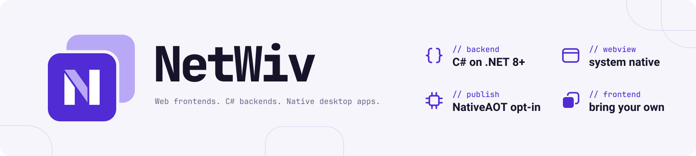
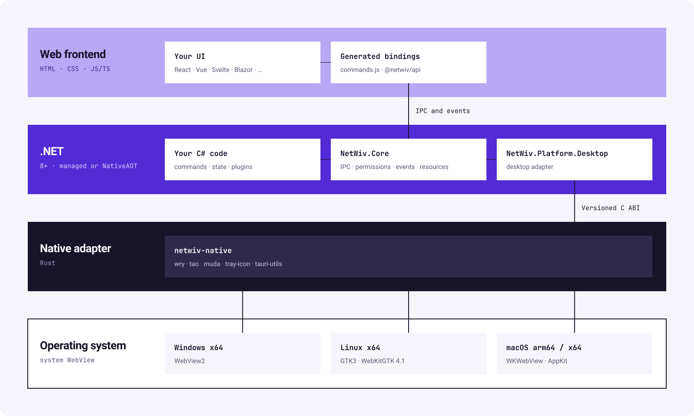

<div align="center">

<picture>
  <source media="(prefers-color-scheme: dark)" srcset="assets/brand/netwiv-banner-dark.svg">
  
</picture>

A .NET 8+ desktop framework built on OS WebViews, with optional NativeAOT publishing.

[](docs/implementation-status.md)
[](https://github.com/kim0522ms/NetWiv/actions/workflows/ci.yml)
[](https://github.com/kim0522ms/NetWiv/releases)
[](LICENSE-APACHE)
[](docs/dotnet-compatibility.md)
[](https://netwiv.github.io/)

[Official website](https://netwiv.github.io/) · [Quick start](#quick-start) · [Architecture](#architecture) · [Documentation](docs/README.md) · [Status](#current-status) · [Development](#development)

</div>

---

Write application commands, state, security policy and plugins in **C#**, then
connect them to your web frontend through generated JavaScript and TypeScript
bindings. NetWiv uses **wry, tao, muda and tray-icon** behind a native adapter
for OS WebViews, windows, menus and tray integration.

NetWiv is meant for teams whose backend is already .NET, and for developers who
want to write their desktop backend in C#. Its desktop frontend SDK is
[`@netwiv/api`](docs/frontend-api.md), initially backed by the pinned Tauri API
while moving toward frontend independence. Core and plugin imports use this
single entry point; direct Tauri frontend integration is retired.

NetWiv is developed and maintained using AI coding agents, including **Codex**
and **Claude Code**. The project began with the maintainer's personal interest
in loop harnesses that put different frontier models in adversarial roles,
challenging one another's implementations and assumptions through repeated
review and revision.

> [!IMPORTANT]
> NetWiv is still immature and under active development. If you would like to
> try it, we recommend starting with a toy project. Packages are currently
> supplied as local feeds; [Release bundles](docs/release-packages.md) are prepared
> as drafts for maintainer review, without publishing to NuGet.org. Full desktop API, security and release acceptance
> are still in progress; full TAURI framework compatibility is not claimed.

## At a glance

| | What you work with |
| :--- | :--- |
| **C# application layer** | A .NET SDK for commands, shared state, permissions and plugins. |
| **Frontend choice** | 18 template choices, including React, Vue, Svelte and Blazor. |
| **Generated bindings** | JavaScript calls and TypeScript declarations generated from C# commands. |
| **Desktop frontend SDK** | `@netwiv/api` in `packages/api`, with mobile-only APIs excluded from its public facade. |
| **Flexible deployment** | Self-contained .NET by default, installed-runtime deployment or optional NativeAOT. [Deployment modes](docs/deployment.md). |
| **Desktop plugin API** | `@netwiv/api/plugins/*` shares the core facade; .NET plugin registration and permissions remain required. |

Ordinary JS/TS and Blazor application development does not require Cargo.
Framework maintainers build the native adapter separately; Rust/WASM frontend
templates require their own Rust toolchain.

NetWiv prioritizes idiomatic .NET usability and stability. TAURI frontend compatibility
remains an important support goal, with deliberate differences documented and
breaking changes accompanied by impact and migration notes. Read the
[design principles](docs/design-principles.md).

## Relationship to the TAURI framework

**Inspired by the [TAURI framework](https://github.com/tauri-apps/tauri), built on its ecosystem.** NetWiv borrows heavily from
the TAURI approach to desktop apps and reuses many of the components that power
it: **[wry](https://github.com/tauri-apps/wry)** for WebViews,
**[tao](https://github.com/tauri-apps/tao)** for windows and the event loop,
**[muda](https://github.com/tauri-apps/muda)** for menus,
**[tray-icon](https://github.com/tauri-apps/tray-icon)** for system tray integration,
and **[tauri-utils](https://github.com/tauri-apps/tauri/tree/dev/crates/tauri-utils)**
for shared configuration types. Its frontend facade privately reuses pinned
**[@tauri-apps/api](https://github.com/tauri-apps/tauri/tree/dev/packages/api)**
and desktop plugin implementations. NetWiv builds on this upstream work while implementing its
application SDK, IPC policy and development tooling in .NET. Some source is
ported or adapted from the TAURI framework; NetWiv is an independent modified
implementation, not an official TAURI core runtime. See the
[runtime identity differences](docs/implementation-status.md#runtime-identity-differences).
Credit belongs to
the TAURI framework contributors and the maintainers of these libraries; their original
licenses and notices are retained. See the [pinned upstream sources](compatibility/README.md)
and [native dependencies](native/netwiv-native/Cargo.toml).

### Reporting issues

**Report NetWiv issues to [NetWiv](https://github.com/kim0522ms/NetWiv/issues), not to the TAURI project.**
NetWiv deliberately reproduces the TAURI frontend API and many of its error
messages so that existing frontend code keeps working. A matching error message
therefore does not mean the problem is in the TAURI framework. If you suspect an upstream
issue, reproduce it in an app built with the official TAURI framework before reporting it there.

## Architecture

The runtime stack connects your web UI and `@netwiv/api` bindings to C#
application code and the native desktop through a versioned C ABI. Linux uses
GTK3/WebKitGTK 4.1 on X11 or Wayland; Windows uses WebView2 and macOS uses
WKWebView/AppKit.

<picture>
  <source media="(prefers-color-scheme: dark)" srcset="assets/diagrams/architecture-dark.svg">
  
</picture>

IPC arrows show logical communication; the native WebView adapter carries the
messages between JavaScript and .NET. C# owns command validation and permission
policy; the native adapter owns the OS event loop, windows, WebViews, menus and
tray objects. At build time, the CLI, source generators and MSBuild produce
bindings, embed frontend assets and publish the application.

## Quick start

Start with the [local package quickstart](docs/integration-quickstart.md) for
the current feed and prerequisites. The example below uses PowerShell and
a supplied package feed; replace both the feed path and `PACKAGE_VERSION`
with actual values before running it. A fresh clone contains no prebuilt feed;
maintainers can [create one from source](docs/development.md#create-a-local-package-feed).

Current packages target `net8.0` and can be consumed by .NET 8, 9 and 10 applications.
See [SDK compatibility](docs/dotnet-compatibility.md)
for SDK selection, runtime behavior and validation limits.

**Windows prerequisites:** .NET 8 or later SDK, Node.js and WebView2 Runtime.
NativeAOT release builds also need Visual Studio C++ Build Tools and Windows SDK.
On Linux, use GTK3 and WebKitGTK 4.1 in an X11 or Wayland session; see
the [Linux guide](docs/linux.md) for prerequisites and compositor limits.
On macOS 12+, use .NET 8 or later and Node.js; WKWebView is provided by the OS.
NativeAOT builds additionally require Xcode Command Line Tools. Follow the [macOS guide](docs/macos.md) and the
[zsh quickstart](docs/integration-quickstart.md#create-the-project).

```powershell
$feed = 'C:\path\to\packages'
$version = 'PACKAGE_VERSION'

dotnet tool install --global NetWiv.Cli --version $version --add-source $feed
netwiv new MyApp --template react --source $feed
Set-Location MyApp

npm ci
npm run desktop:dev
```

If the global tool is already installed, use `update` instead of `install`.
The generated project includes matching SDK references, frontend bindings and a
local CLI manifest. `desktop:dev` handles binding generation, Vite and the app
process, including frontend updates and C# backend restarts.

`npm ci` installs `@netwiv/api` from the starter's portable `vendor/netwiv-api`
directory, including its private implementation and notices. No upstream frontend
package is installed as a runtime dependency.
Generated bindings import `@netwiv/api/core`; use `@netwiv/api` modules for new
frontend code. This local distribution works without an npm registry release.
See [frontend SDK usage and migration](docs/frontend-api.md).

Explore the [template matrix](docs/template-coverage.md) or the
[project creation options](docs/project-creation.md#creation-options).

## Current status

Desktop targets are **Windows x64**, **Linux x64 on Ubuntu 24.04 / WSLg**, and
**macOS arm64/x64**. Linux supports X11 and native Wayland with different platform
constraints; see the [Linux](docs/linux.md) and [macOS](docs/macos.md) guides.

| Platform | WebView stack | Selected integration checks |
| :--- | :--- | :--- |
| Windows x64 | WebView2 | React + C# NativeAOT app; NSIS/MSI installation, execution and removal. |
| Linux x64 | GTK3 + WebKitGTK 4.1 | X11 React + C# NativeAOT integration; managed/NativeAOT Wayland lifecycle, IPC, menu/tray, input and dialog checks on Ubuntu 22.04 GNOME. Physical Ubuntu 24.04 Wayland acceptance remains unverified. |
| macOS arm64 / x64 | WKWebView + AppKit | Hosted NativeAOT integration and package-consumer checks on both architectures; selected physical Apple Silicon GUI and local app/DMG checks. Physical Intel GUI and minimum-OS acceptance remain unverified. |

These are focused application checks. Real-certificate signing, WebView2-absent
installation and full upstream conformance remain acceptance gaps. Wayland global
positioning, stacking and native global shortcuts are outside the verified
baseline, and not every optional plugin's native behavior is validated. See the
[support and validation guide](docs/implementation-status.md)
for coverage and limits, and the [per-API status table](docs/api-status.md) for
implemented, planned and unimplemented behavior.

## Documentation

Visit the [official NetWiv website](https://netwiv.github.io/) for a project
overview. Browse the [documentation index](docs/README.md) for getting-started
guides, API references, and framework development documentation.

| Start here | Reference |
| :--- | :--- |
| **Build your first app** | [Package quickstart](docs/integration-quickstart.md) · [Templates](docs/template-coverage.md) |
| **Connect C# and the frontend** | [C# API](docs/csharp-api.md) · [Frontend SDK](docs/frontend-api.md) · [Generated bindings](docs/frontend-generator.md) |
| **Add plugins** | [Plugin commands](docs/plugin-commands.md) · [Plugin configuration](docs/plugin-configuration.md) · [Plugin status](docs/official-plugins.md) |
| **Understand support** | [API status](docs/api-status.md) · [Support and validation](docs/implementation-status.md) |
| **Understand the design** | [Design principles](docs/design-principles.md) |
| **Work on the framework** | [Native ABI](docs/native-abi.md) · [Native architecture](docs/native-architecture.md) · [Version pins](compatibility/README.md) · [Conformance](tests/conformance/README.md) |

## Development

Want to contribute? Read the [contribution guide](CONTRIBUTING.md) for the
workflow, AI-assisted contribution responsibilities and required validation
evidence before opening a PR.

See the [framework development guide](docs/development.md) for prerequisites
and package creation. Build and run managed checks with .NET 8 or later:

```sh
dotnet build NetWiv.sln -c Release
dotnet run --project tests/NetWiv.Core.Tests -c Release --no-build
dotnet run --project tests/NetWiv.Cli.Tests -c Release --no-build
dotnet test tests/NetWiv.Generators.Tests -c Release --no-build
dotnet test tests/NetWiv.Api.Tests -c Release --no-build
node --test tests/conformance/scripts/compare-results.test.mjs
```

<details>
<summary><strong>Native adapter builds and desktop smoke checks</strong></summary>

Framework maintainers build the Rust adapter explicitly using
`scripts/build-native.ps1` on Windows or `bash scripts/build-native.sh` on Linux/macOS.
Rust 1.95.0, the platform C/C++ linker and the OS WebView development dependencies
are required for that source build. Linux uses GTK3 and WebKitGTK 4.1.

The integrated native sample is `tests/NetWiv.Desktop.Smoke`. Publish it with:

```sh
dotnet publish tests/NetWiv.Desktop.Smoke -c Release -r win-x64
# On Linux, use -r linux-x64; on macOS, use -r osx-arm64 or osx-x64.
```

Run the published executable to test two windows, three webviews, official JS
invoke/Channel, menus, images, tray resources and shutdown. Set
`NETWIV_SMOKE_HOLD_MS=120000` to keep its integrated UI available for inspection.
A successful build alone is not a successful GUI test.

The missing-library, missing-export and wrong-ABI startup tests use deliberately
incompatible fixture libraries in isolated artifact directories:

```powershell
./scripts/test-native-startup.ps1 -PublishedDirectory artifacts/wry-smoke/win-x64
```

On Linux/macOS run `bash scripts/test-native-startup.sh /absolute/smoke/publish`.
These maintainer tests require the pinned Rust compiler and never launch a GUI.

NuGet delivery includes RID-specific native libraries. Ordinary application
restore/build/publish will not invoke Cargo or download libraries at runtime.
Packing the framework requires native artifacts for all four supported RIDs to exist.

</details>

## License

NetWiv is licensed under [Apache-2.0](LICENSE-APACHE).
Copyright © 2026 kim0522ms and NetWiv contributors.

The TAURI framework and other third-party components retain their original licenses and
copyright notices. See [NOTICE](NOTICE), [third-party notices](THIRD-PARTY-NOTICES.md)
and the preserved [TAURI MIT license](licenses/Tauri-MIT.txt).

---

TAURI® is a trademark of The Tauri Programme within the Commons Conservancy.
WRY and TAO are trademarks of The Tauri Programme within the Commons Conservancy.

NetWiv is an independent project. Its framework, plugins and templates are not affiliated with, endorsed by, or officially approved by The Tauri Programme within the Commons Conservancy.
