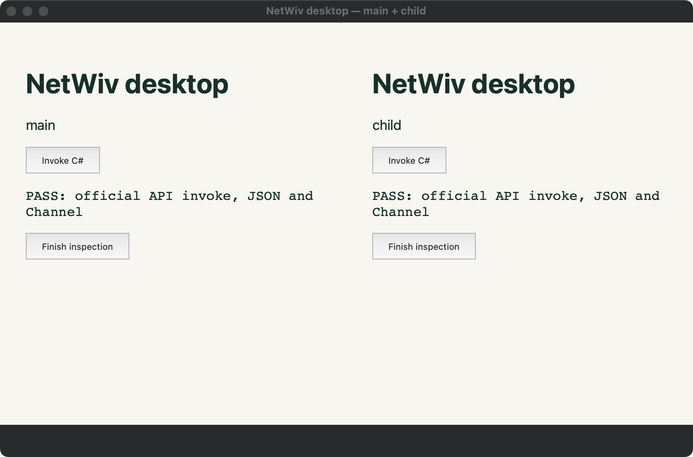
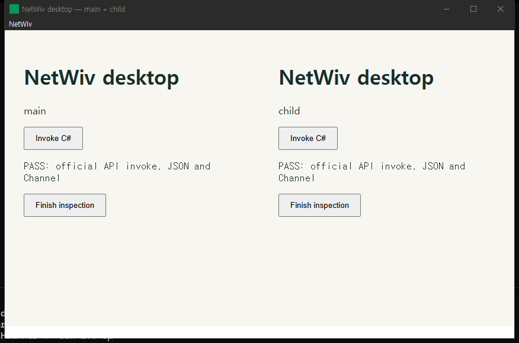

# Runtime module refactor validation

Recorded on 2026-10-12 for implementation commit
`0cafe0fbfe99864de39f0cb6f016de7b616e32ae`, based on
`212809a9e78c28d4081c467dc4de1fff988ba73c`. The original device results below
apply to that implementation. A later Linux compile fix is recorded separately.

## Linux compile follow-up

PR #15 CI run [38208125844](https://github.com/kim0522ms/NetWiv/actions/runs/38208125844)
failed because the extracted Linux `monitor_work_area` function lacked imports
for `LogicalPosition` and `LogicalSize`. The fix imports both types inside that
Linux-only function; conversion behavior and the other platforms are unchanged.

On Ubuntu 22.04 x64 in WSL2 (kernel 6.6.87.2, Rust 1.95.0), commit `7654ade`
reproduced both `E0433` errors. With only the import line added, the native
library/test build passed, all 48 headless tests passed, and the initially ignored
GTK menu test passed separately under Xvfb/D-Bus. macOS arm64 native tests were
rerun: 49 passed. [Before/after Linux output](linux-import-fix.log) records the
compiler regression and test results. WSL/Xvfb is virtual/headless evidence,
not Linux physical-desktop or full WebView/NativeAOT validation.

Reproduce with Rust 1.95.0 and the Linux prerequisites in the CI workflow:

```sh
node scripts/prepare-native-dependencies.mjs linux-x64 artifacts/native-source/ci
export SODIUM_DIST_DIR="$PWD/artifacts/native-source/ci"
cargo +1.95.0 test --locked --manifest-path native/netwiv-native/Cargo.toml
xvfb-run -a dbus-run-session -- cargo +1.95.0 test --locked \
  --manifest-path native/netwiv-native/Cargo.toml \
  native_menu_replacement_and_accelerator_dispatch -- --ignored --test-threads=1
```

No behavioral test was added for this import-only fix: compiling the actual
Linux library and test target reproduces the failure directly. Existing Linux
CI remains the release-build and NativeAOT gate.

## Results and limits

| Check | macOS arm64 | Windows x64 |
| --- | --- | --- |
| Native unit tests | 49 passed | 50 passed; one desktop-only test initially ignored |
| Explicit native menu replacement/accelerator desktop test | Not defined on macOS | 1 passed in the interactive console session |
| Generator tests | 150 passed | Not rerun separately |
| Managed core tests | 219 passed | 219 passed |
| .NET 8 NativeAOT core execution | 219 passed | 219 passed |
| Managed full desktop smoke | Passed | Final uninstrumented run passed; earlier timeout remains unexplained |
| .NET 8 NativeAOT full desktop smoke | Passed | Final uninstrumented run passed |
| Managed and NativeAOT windowless smoke | Both passed | Both passed |
| Contract/inventory JavaScript tests | 15 passed | Not rerun separately |

**Windows stability follow-up remains open; this PR is a draft.** Initial runs
failed with WebView2 `0x80070057` (`E_INVALIDARG`) when creating a child named
`temporary`. The same NativeAOT consumer with a freshly built baseline native DLL
(`212809a`) failed at the same step. Later diagnostic runs, including 100 repeated
creations, did not reproduce that error. A subsequent uninstrumented managed run
timed out before the Stronghold milestone; a diagnostic attempt later stopped at
the repeated-creation phase. Its managed stack showed the UI thread in native
code and idle .NET workers, which does not locate the native cause. A traced
native run then passed without needing its diagnostic wake-up operation.

The final **uninstrumented** managed and NativeAOT runs passed every desktop and
windowless assertion, including remote-origin denial and resource cleanup. Their
native DLL SHA-256 is
`4f2965c1e67c8184c37ad771f6e7a6f36ba51dc9228a58e366c0eeae861f942b`.
These passes do not prove that the earlier intermittent failures were fixed.
The two confirmed probe races described below were repaired; no speculative
native retry, delay or focus workaround was added. Temporary diagnostics were
removed, and the restored wry source hash matches the pinned cache byte for byte.

Linux, Intel macOS and minimum-supported macOS were not physically tested in
this change. CI results are separate evidence and must not be described as
physical-device validation. Installer lifecycle and full upstream conformance
were not part of these runs.

## Devices and tools

- Physical Mac14,9, Apple M2 Pro, arm64, macOS 15.4 (24E248), logged-in AppKit
  desktop using the system WKWebView. Managed runtime 8.0.13; NativeAOT published
  with SDK 8.0.406. Generator/managed-core builds used SDK 10.0.301 targeting net8.0.
- Physical Lenovo 20S60006KR, Intel Core i7-10510U, Windows 10 Pro 10.0.19045 x64,
  WebView2 154.0.4258.62. Managed runtime 8.0.21; NativeAOT published with SDK
  8.0.415. Managed-core build used SDK 10.0.301 targeting net8.0. Builds/core tests
  ran over SSH; GUI and the ignored native menu test ran as the logged-in user
  through transient interactive scheduled tasks, which were removed afterward.
- Rust 1.95.0 and unchanged locked dependencies: wry 0.55.1, tao 0.35.3,
  muda 0.19.3 and tray-icon 0.24.2. Toolchains were installed into isolated
  validation directories without changing the user's default toolchain.

## What was checked

The structural commit `15f2539` was audited before extending the desktop probe.
The original 211 Rust function bodies (including existing tests) were compared
with their moved counterparts, allowing only module qualification, visibility,
indentation and relocated fixture paths. No original body was lost or changed.
The C# partials retain every original non-import/declaration line, including
emitted string literals and diagnostics. Captured `NetWiv.Commands.g.cs` and
`NetWiv.Plugins.g.cs` consumer outputs match the baseline byte for byte.

The resource tests additionally check wrong-kind access without corrupting the
live image, stale handles after close/reallocation, and RID exhaustion without
overwriting an existing resource. The existing core suite exercises static and
instance commands, DI scopes, concurrent invocation, cancellation, failure and
disposal in both managed and NativeAOT execution.

The full-desktop scenarios traverse unchanged guest JavaScript,
C# IPC and the native ABI: multiple windows and child WebViews, generated plugin
commands and ACLs, image/menu/tray resources, reparenting, repeated creation and
cleanup, reload invalidation of pending replies/channels, remote-frame isolation,
Stronghold, platform window operations and shutdown. Windowless scenarios cover
menu/tray creation, dispatch and shutdown without an initial window.

The desktop probe additionally covers all four parent/child visibility combinations,
explicit initial focus, showing and focusing a previously hidden WebView, and a
hidden implicit-root window. Each is destroyed and checked for native registry
cleanup. A discovered test race was fixed: `reload_barrier` previously assumed
separate IPC commands executed in send order. It now awaits `pending_reload`
setup through a task completion source before checking document identity. Stale
reply/channel assertions and timeout failures remain enabled.

A second probe bug caused Windows origin-denial timeouts: a browser's idle TCP
preconnection could occupy the single request-processing loop indefinitely.
The probe now accepts clients independently and cancels/drains them at shutdown.
A socket regression fails before the fix with a five-second HTTP timeout and
passes afterward; it includes an abandoned connection, an idle connection held
open across another request and server disposal, and a negative denial result.
It also runs inside the full desktop scenario. Run it independently without a
GUI via `NetWiv.Desktop.Smoke --origin-probe-smoke` (add `.exe` on Windows).

Coverage was inspected rather than treated as a compatibility claim:
CommandGenerator partials cover 558/584 unique lines (95.55%); the whole generator
assembly covers 95.14% of lines and 83.33% of branches. Native macOS unit and
real-desktop/windowless execution together cover 63.26% of native source lines
(excluding test source and Rust standard-library source). Unexercised native
commands, error paths and other OS branches remain. Native GUI coverage used an
optimized instrumented library because the unoptimized Stronghold snapshot path
was too slow; the ordinary managed/AOT smoke results used the release library. The updated managed desktop probe was
also measured on macOS: all added visibility/lifecycle and reload-barrier lines
were executed; `Program.cs` covers 259/315 lines (82.22%) in the full-GUI run.
Its separate startup-error/windowless branches were not part of that coverage run.
`OriginProbe.cs` covers 51/58 lines (87.93%); unexecuted lines include test assertion
failures, unexpected listener failures and socket I/O failures. Idle cancellation,
client EOF, concurrent requests and negative/positive result handling were exercised.

## Reproduction

Use the pinned native toolchain, verified libsodium inputs and prerequisites in
[the development guide](../../development.md). Run from the repository root:

```sh
cargo +1.95.0 test --locked --manifest-path native/netwiv-native/Cargo.toml
bash scripts/build-native.sh  # Windows: ./scripts/build-native.ps1

dotnet test tests/NetWiv.Generators.Tests -c Release
dotnet run --project tests/NetWiv.Core.Tests -c Release
```

Select .NET SDK 8 with a validation-local `global.json` before publishing. For
`RID=osx-arm64` or `win-x64` (append `.exe` when executing on Windows):

```sh
dotnet publish tests/NetWiv.Core.Tests -c Release -r "$RID" -p:PublishAot=true -o artifacts/check/core-aot
artifacts/check/core-aot/NetWiv.Core.Tests

dotnet publish tests/NetWiv.Desktop.Smoke -c Release -r "$RID" -p:PublishAot=true -o artifacts/check/desktop-aot
dotnet publish tests/NetWiv.Desktop.Smoke -c Release -r "$RID" -p:PublishAot=false --self-contained false -o artifacts/check/desktop-managed
artifacts/check/desktop-aot/NetWiv.Desktop.Smoke
artifacts/check/desktop-aot/NetWiv.Desktop.Smoke --no-window-smoke
artifacts/check/desktop-managed/NetWiv.Desktop.Smoke
artifacts/check/desktop-managed/NetWiv.Desktop.Smoke --no-window-smoke
```

Run the GUI commands in a real interactive desktop session. On Windows also run
`cargo +1.95.0 test --locked --manifest-path native/netwiv-native/Cargo.toml native_menu_replacement_and_accelerator_dispatch -- --ignored` there.
Set `NETWIV_SMOKE_HOLD_MS=20000` to capture the inspection stage. A screenshot of
that stage alone does not prove subsequent cleanup; consult the completed log.

The moved evidence paths were checked with:

```sh
node compatibility/scripts/generate-upstream-manifests.mjs --tests-only
node --test compatibility/scripts/upstream-test-inventory.test.mjs tests/conformance/scripts/*.test.mjs
node compatibility/scripts/report-api-coverage.mjs artifacts/api-report.json
```

## Captured evidence

- [macOS logs](macos.log): native/generator/core tests, full desktop and windowless
  runs, function-body audit and contract harness results.
- [Windows logs](windows.log): initial failures/baseline-native comparison and
  final uninstrumented passing checks, plus the diagnostic stack. Checkout path
  prefixes are redacted.
- [Coverage summary](coverage.txt): generator measurements and native per-module
  report from the bounded runs above.

The actual macOS NativeAOT window below shows main/child guest invocation,
JSON and channel success. Its completed log also records the later origin-denial
and resource-cleanup checks.



The final Windows NativeAOT inspection stage is shown below. The completed log
also verifies the subsequent remote-origin denial and resource cleanup.


